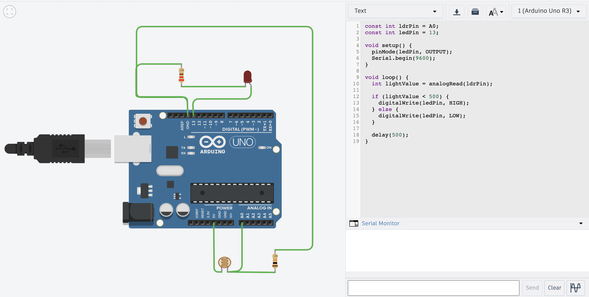

# AUTOMATIC STREET LIGHT SYSTEM
## Automatic street light system using Arduino uno and LDR sensor

### Hardware Components
 * Arduino Uno
 * LDR Sensor
 * 10k Ohm Resistor
 * 220 ohm Resistor
 * LED or Bulb
 * Relay Module
 * Jumper Wires
### How It Works
 * The LDR sensor detects the ambient light.
 * When it gets dark, the sensor detects low light.
 * The sensor sends a signal to the Arduino.
 * Arduino triggers the relay module or LED to switch on.
### Code
const int ldrPin = A0;

const int ledPin = 13;

void setup() 

{
  pinMode(ledPin, OUTPUT);
}

void loop() 

{
  int lightValue = analogRead(ldrPin);
  
  if (lightValue < 500)
  
  {
    digitalWrite(ledPin, HIGH);
  } 
  
  else 
  
  {
    digitalWrite(ledPin, LOW);
  }
}
### code explanation
 * pins: ldrPin is defined for the LDR sensor at A0, and ledPin is defined for the LED at 13.
 * setup: sets ledPin as an output device using pinMode().
 * loop: reads light levels from the LDR using analogRead().
 * lightValue < 500: this condition indicates darkness, turning the LED ON.
 * else: when there is sufficient light, the LED remains OFF.
